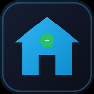

<p align="center">
  
</p>

<h1 align="center">ESP32 Smart Home</h1>

<p align="center">
  <b>4-channel Wi-Fi relay controller with captive-portal setup, an app-like dashboard,<br/>
  hotspot fallback and free Google Home / Gemini voice control — no hub, no subscription.</b>
</p>

<p align="center">
  
  
  
  <a href="https://github.com/rishabhsinghrathaur/esp32-smart-home/actions/workflows/build.yml"></a>
</p>

---

Make your home smart with one ESP32, two relay modules and this firmware.
Everything local works **without internet**; voice control is a free, optional
extra bridged through Arduino Cloud → Google Home.

> ⚠️ **Mains safety:** the relay contacts can switch mains voltage. Wire the
> relay board and the wall switches only if you are qualified, and keep the
> low-voltage side isolated. Never work on live mains. See
> [docs/WIRING.md](docs/WIRING.md).

## Why this project

- **Zero re-flashing:** Wi-Fi credentials are entered once through a captive
  portal. Changing routers or ISPs is a 2-minute phone task.
- **Never fully unreachable:** if the home Wi-Fi dies, the device opens its own
  password-protected hotspot so you still reach the dashboard.
- **Feels like an app:** installable shortcut with real icons, dark dashboard,
  fixed `http://smarthome.local` address.
- **Free voice control:** Google Home / Gemini integration through the free
  Arduino Cloud plan. No Raspberry Pi, hub or paid tier.
- **Local-first:** switches, schedules, timers and analytics keep working with
  no internet at all.

## Features

| Area | What you get |
| --- | --- |
| Wi-Fi | Captive-portal setup page (open `SmartHome-Setup` hotspot on first boot), network scan, optional static IP, WPA2 2.4 GHz |
| Fallback | Password-protected `SmartHome-Fallback` hotspot when the router is unreachable, auto-closes when Wi-Fi returns |
| Dashboard | App-like dark UI with master switch, per-channel names and 8 icons, power-on behaviour, inching/pulse, sleep timers |
| Schedules | Daily ON/OFF schedules per channel with a 2-minute catch-up window (NTP-synced clock) |
| Analytics | Today's / all-time runtime, switch cycles, 20-event activity log, per-channel |
| Physical | Wall switches in toggle mode, momentary push-buttons, safe state seeding at boot |
| Voice | Free Arduino Cloud → Google Home → Gemini/Assistant integration, device-state-wins on reconnect |
| Updates | Web OTA (`/update`) and ArduinoOTA, both password protected |
| Security | Setup mode blocks relay control, origin checking on mutating endpoints, no port-forwarding needed |

## Hardware

| Part | Notes |
| --- | --- |
| ESP32 Dev Module | Any 4 MB board |
| 2× 2-channel relay module | **Active-LOW inputs** (set `RELAY_ACTIVE_LOW` in the sketch if yours differ), optocoupled |
| 4 wall switches or push-buttons | Wired to GND, internal pull-ups |
| 5 V power supply | Powers ESP32 and relay coils (do not power coils from the 3.3 V pin) |
| Status LED | Optional, on GPIO 2 |

**Wiring table, connection order and safety notes: [docs/WIRING.md](docs/WIRING.md).**

| Function | GPIO |
| --- | --- |
| Relay 1 (IN1) | 23 |
| Relay 2 (IN2) | 22 |
| Relay 3 (IN1, module 2) | 21 |
| Relay 4 (IN2, module 2) | 19 |
| Switch 1 → GND | 13 |
| Switch 2 → GND | 12 |
| Switch 3 → GND | 14 |
| Switch 4 → GND | 27 |
| Status LED | 2 |

## Quick start

1. **Clone** this repository and open the sketch in the Arduino IDE.
2. **Install libraries** — Library Manager → `ArduinoIoTCloud` (it pulls in its
   dependencies). Board: **ESP32 Dev Module**.
3. **Credentials (optional, voice only):**
   ```bash
   cp cloud_config.example.h cloud_config.h
   ```
   Fill in your Arduino Cloud Board ID / Device Key (see
   [docs/VOICE-CONTROL.md](docs/VOICE-CONTROL.md)), or leave them empty —
   everything local works without the cloud. `cloud_config.h` is git-ignored,
   so your credentials never leave your machine.
4. **Partition scheme** — Tools → Partition Scheme → **No FS 4MB (2MB APP x2)**.
   The firmware is larger than the default 1.2 MB app partition (exact option
   name varies by ESP32 core version; any scheme with a ≥ 2 MB app partition
   works, e.g. *Huge APP*).
5. **Upload** once over USB. Later updates go through the web OTA page.

### First boot: Wi-Fi setup

The device opens an **open** hotspot `SmartHome-Setup`. Join it with your phone
— the captive portal opens automatically (or browse to **http://192.168.4.1/**),
pick your 2.4 GHz network, enter the password, optionally set a static IP, and
tap **Save & Connect**.

- The ESP32 sees **2.4 GHz only**. 5 GHz-only or hidden SSIDs must be typed
  manually. WPA3-only networks may fail — use WPA2/WPA3 mixed mode.
  Enterprise (802.1X) networks are not supported.
- After it joins your Wi-Fi, open **http://smarthome.local** (mDNS; on Windows
  you may need Bonjour, otherwise use the IP from your router's client list).
- Change networks later from **Wi-Fi & Network** (`/wifi`) in the dashboard.

### Hotspot fallback

- Router unreachable for 30 s → the device opens **`SmartHome-Fallback`**,
  protected by the hotspot/OTA password (default `smarthome1234` — **change it**
  in Settings → Hotspot / OTA password). Any phone joining it is redirected to
  the dashboard.
- The fallback closes 60 s after home Wi-Fi returns.
- The open setup hotspot serves only the setup page; relay control is blocked
  while the device is unconfigured.

### App-like shortcut

The dashboard ships a web app manifest and real PNG icons:

- **Android Chrome:** menu → **Add to Home screen**.
- **iPhone/iPad Safari:** Share → **Add to Home Screen** (opens full-screen).

Create the shortcut while on your **home Wi-Fi**, not on the fallback hotspot —
the shortcut remembers the address it was created from. There is deliberately
no service worker/cache: the dashboard always reflects the live device.

## Using the dashboard

- Master **All ON / All OFF**
- Per-channel: name, 8 icons, power-on default, **inching/pulse**, **sleep timer**
- Daily schedules with a 2-minute catch-up window (needs NTP time)
- Today's runtime, all-time runtime, switch cycles, 20-event activity log
- Settings: timezone, hotspot/OTA password, network status, reboot
- Web OTA at `/update` (user `admin`, password = hotspot/OTA password)
- Arduino IDE network-port OTA uses the same password

Timers are intentionally not persisted across a reboot; schedules are.

## Voice control (free, no extra hardware)

The Gemini app can only control devices **Google Home** knows about. The free
Arduino Cloud plan bridges this device to Google Home — no hub or subscription.

**Full step-by-step guide: [docs/VOICE-CONTROL.md](docs/VOICE-CONTROL.md).**
The short version: create an Arduino Cloud Thing with four Smart-home Switch
variables (`relay1`…`relay4`), enable the Google Home integration, paste the
Board ID and Secret Device Key into `cloud_config.h`, then link the Arduino
service in the Google Home app and enable Gemini's *Device control* extension.

Voice commands need internet and a live Arduino Cloud connection. The local
dashboard, switches and schedules keep working without it.

## Local API (advanced)

All mutating endpoints are `POST` and intended for the local network:

```
POST /toggle?relay=0
POST /all?state=1
POST /save_config?relay=0&name=Light&icon=lightbulb&timer=0&power=2&inching=0&sched=0&onH=18&onM=0&offH=22&offM=0
POST /set_tz?tz=5.5
GET  /status
GET  /wifi_info
GET  /scan
```

## Security

- The setup hotspot is open but serves only the setup page and blocks relay
  control until Wi-Fi is provisioned.
- The fallback hotspot and both OTA paths are protected by the hotspot/OTA
  password. Change the default.
- The normal dashboard has no login — it is meant for a trusted LAN. **Do not
  port-forward the device**; use Google Home / Arduino Cloud for outside access.
- `cloud_config.h` holds device credentials and is git-ignored; never commit it.

## Troubleshooting

| Symptom | Check |
| --- | --- |
| `SmartHome-Setup` does not appear | Power cycle; watch serial at 115200. The Wi-Fi scan takes a few seconds. |
| Network not in the scan list | It is 5 GHz-only or hidden — enter the 2.4 GHz name manually. |
| Connects, then drops | Signal strength, WPA3-only mode, router MAC filtering, DHCP pool. |
| `smarthome.local` does not resolve | Use the IP; Windows needs mDNS/Bonjour. Static IP is available in `/wifi`. |
| Dashboard says Reconnecting | Device rebooting or network dropped; check serial and the status LED. |
| Unreachable after a static IP change | Reboot and re-join the fallback/setup hotspot, or erase flash and reconfigure. |
| Voice shows Offline | Internet/NTP, Board ID/Device Key, Google Home account link. |
| Web OTA says FAIL | Not a valid `.bin` for this board, or wrong partition scheme. |
| Firmware does not fit | Select a ≥ 2 MB app partition (see Quick start). |

Serial monitor: **115200 baud**. Status LED: solid = connected, fast blink =
setup mode, slow blink = fallback hotspot.

## Project structure

| Path | Purpose |
| --- | --- |
| `esp32-smart-home.ino` | Main firmware |
| `wifi_setup.h` | Captive-portal Wi-Fi setup page |
| `web_assets.h` | Dashboard, OTA page, manifest, SVG icon |
| `app_icons.h` | Embedded PNG app icons (generated — see `tools/`) |
| `cloud_config.example.h` | Template for your local, git-ignored `cloud_config.h` |
| `tools/make_icons.py` | Regenerates `icons/` and `app_icons.h` |
| `icons/` | Source PNGs (180, 192, 512 px) |
| `docs/` | Wiring guide and voice-control walkthrough |
| `.github/workflows/build.yml` | CI compile check on every push and PR |

## Contributing

Bugs, ideas and pull requests are welcome — see
[CONTRIBUTING.md](CONTRIBUTING.md). Please keep credentials out of commits and
test on real hardware before sending a PR; the CI only proves it compiles.

## License

[MIT](LICENSE)

---

## References

- Arduino Cloud — Google Home guide: <https://docs.arduino.cc/arduino-cloud/guides/google-home/>
- Arduino Cloud plans (free tier limits): <https://cloud.arduino.cc/plans/>
- Google Gemini — control smart home devices: <https://support.google.com/gemini/answer/15335456>
